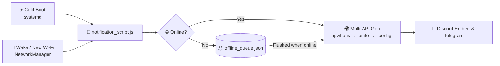

<div align="center">

# 🚨 Kali Linux Startup & Network Notifier (v2.1)

**A lightweight, zero-dependency Node.js daemon that sends rich system, battery, Wi-Fi, and geolocation alerts to Discord (and optional Telegram) on boot, wake-from-sleep, or network change.**

[](https://github.com/qaurav/kali-startup-notifier/actions/workflows/test-notifier.yml)


</div>

---

## ✨ Key Features

- **Cold Boot, Wake & Wi-Fi Triggers:** Fires on system startup (`systemd`) **and** whenever your machine wakes from suspend or connects to a new network (`NetworkManager` dispatcher).
- **Offline Store-and-Forward Queue:** If your laptop boots without internet access, the timestamp and battery level are saved to `offline_queue.json` and flushed automatically once connectivity returns.
- **Multi-Provider IP Geolocation Fallback:** Chains `ipwho.is` → `ipinfo.io` → `ifconfig.co` using native `fetch()` so a single API outage never breaks location alerts.
- **Zero External Dependencies:** Built strictly on modern `node:` core modules (`node:os`, `node:fs`, `node:path`, `node:child_process`) and native `fetch()`.
- **Optional Telegram Backup Channel:** Supports simultaneous delivery to Telegram alongside Discord.

---

## 📱 Alert Preview

> **Kali System Notifier** `APP`
>
> 🔴 **ALERT:** System (`kali`) online from **Kathmandu, Bagmati Province, Nepal**!
>
> | Field | Value |
> | :--- | :--- |
> | 🖥️ **Hostname & OS** | `kali` (`linux` / `x64`) |
> | ⚡ **Trigger** | `Cold Boot` |
> | ⏱️ **Uptime** | `0m` |
> | 🌐 **Public IP** | `203.0.113.42` |
> | 🏢 **ISP / Org** | `WorldLink Communications` |
> | 📍 **Location** | `Kathmandu, Bagmati Province, Nepal` *(via ipwho.is)* |
> | 📶 **Wi-Fi / Network** | `Home-WiFi (AA:BB:CC:DD:EE:FF)` |
> | 🔋 **Battery / Power** | `87% (Discharging)` |
> | 🔌 **Local IP(s)** | `wlan0: 192.168.1.105` |

---

## ⚙️ Architecture



---

## 💻 Linux Compatibility

| Environment | Status | Notes |
| :--- | :--- | :--- |
| **Kali, Ubuntu, Debian, Mint, Pop!_OS** | ✅ Full Support | Cold boot (`systemd`) + wake/Wi-Fi triggers (`NetworkManager`) |
| **Fedora, Arch, Manjaro, openSUSE, RHEL** | ✅ Full Support | Works out of the box with Node.js v18+ |
| **Headless Linux Servers & Cloud VMs** | ✅ Supported | Skips `NetworkManager` hook; reports AC power & Ethernet cleanly |
| **Alpine, Void, Gentoo, Devuan** | ❌ Unsupported | Requires `systemd` (`systemctl` is not present on OpenRC/`runit`/`sysvinit`) |
| **Docker Containers / Non-systemd WSL** | ❌ Unsupported | Containers do not run `systemd` as PID 1 |

---

## 🚀 Quick Start

### 1. Install Prerequisites (Node.js v18+)
```bash
sudo apt update && sudo apt install -y nodejs
node -v   # Must be v18.0.0 or higher
```
> [!TIP]
> **Get a Discord Webhook URL:**
> Open Discord → **Server Settings** → **Integrations** → **Webhooks** → **New Webhook** → Select channel → **Copy Webhook URL**.

### 2. Clone & Run Installer
```bash
git clone [https://github.com/qaurav/kali-startup-notifier.git](https://github.com/qaurav/kali-startup-notifier.git)
cd kali-startup-notifier
sudo ./install.sh
```
Paste your **Discord Webhook URL** when prompted (and optionally a Telegram Bot Token/Chat ID).

### 3. Test Immediately
```bash
sudo systemctl start kali-notifier.service
```

---

## 🛠️ Management & Troubleshooting

| Action | Command |
| :--- | :--- |
| **Trigger manual test alert** | `sudo systemctl start kali-notifier.service` |
| **Bypass 10s cooldown for rapid testing** | `sudo -u $USER node /opt/kali-notifier/notification_script.js "Manual Test" --force` |
| **View service logs** | `journalctl -u kali-notifier.service -n 25 --no-pager` |
| **Edit webhook / Telegram keys** | `sudo nano /opt/kali-notifier/.env` |
| **Disable boot alerts** | `sudo systemctl disable kali-notifier.service` |

<details>
<summary>🗑️ <b>Completely Uninstall</b></summary>

```bash
sudo systemctl disable --now kali-notifier.service
sudo rm -f /etc/systemd/system/kali-notifier.service
sudo rm -f /etc/NetworkManager/dispatcher.d/99-kali-notifier
sudo rm -rf /opt/kali-notifier
sudo systemctl daemon-reload
```
</details>

---

## 🔒 Security & License

- Secrets live exclusively in `/opt/kali-notifier/.env` (`chmod 600`, owned by your user) and are excluded via `.gitignore`.
- Both `systemd` and `NetworkManager` execute the script as your unprivileged user rather than `root`.
- Released under the [MIT License](LICENSE).
