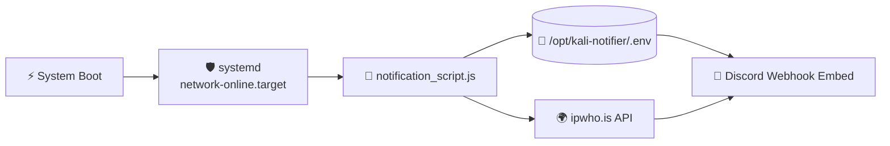

<div align="center">

# 🚨 Kali Linux Startup Discord Notifier

**A lightweight, zero-dependency Node.js daemon that sends rich system & network telemetry alerts to Discord the moment your Linux machine boots.**

[](https://github.com/qaurav/kali-startup-notifier/actions/workflows/test-notifier.yml)


</div>

---

## 📱 Alert Preview

Whenever your device powers on and connects to the internet, you receive an instant notification in your Discord channel:

> **Kali Boot Notifier** `APP`
>
> 🔴 **ALERT:** System (`kali`) booted up from **Kathmandu, Nepal**!
>
> | Field | Value |
> | :--- | :--- |
> | 🖥️ **Hostname** | `kali` (`linux` / `x64`) |
> | 🌐 **Public IP** | `203.0.113.42` |
> | 🏢 **ISP / Org** | `WorldLink Communications` |
> | 📍 **Location** | `Kathmandu, Bagmati Province, Nepal` |
> | 🔌 **Local IP(s)** | `eth0: 192.168.1.105` |

---

## ⚙️ How It Works



1. **`systemd` waits for connectivity** (`network-online.target`) so the alert doesn't fail before Wi-Fi or Ethernet connects.
2. **Zero external `npm` packages** — uses only built-in Node.js modules (`os`, `fs`, `https`) to read `.env`, gather interface IPs, and resolve geolocation.
3. **One-shot execution** (`Type=oneshot`) sends the Discord payload and exits cleanly without consuming background RAM.

---

## 🚀 Quick Start

### 1. Prerequisites
Ensure **Node.js** is installed and create a **Discord Webhook**:
```bash
sudo apt update && sudo apt install -y nodejs
```
> [!TIP]
> **How to get a Discord Webhook URL:**
> Open Discord → **Server Settings** → **Integrations** → **Webhooks** → **New Webhook** → Select your target channel → **Copy Webhook URL**.

### 2. Clone & Install
```bash
git clone [https://github.com/qaurav/kali-startup-notifier.git](https://github.com/qaurav/kali-startup-notifier.git)
cd kali-startup-notifier
sudo ./install.sh
```
Paste your **Discord Webhook URL** when prompted and press **Enter**.

> [!IMPORTANT]
> **What `install.sh` configures automatically:**
> - Auto-detects your `node` binary path and active user
> - Installs the script into `/opt/kali-notifier/notification_script.js`
> - Stores your webhook in `/opt/kali-notifier/.env` locked with `chmod 600`
> - Registers and enables `/etc/systemd/system/kali-notifier.service`

### 3. Send a Test Alert (No Reboot Needed)
```bash
sudo systemctl start kali-notifier.service
```

---

## 🛠️ Service Management Cheat Sheet

| Action | Command |
| :--- | :--- |
| **Trigger alert manually** | `sudo systemctl start kali-notifier.service` |
| **View live execution logs** | `journalctl -u kali-notifier.service -n 20 --no-pager` |
| **Check if enabled on boot** | `systemctl is-enabled kali-notifier.service` |
| **Change Discord Webhook** | `sudo nano /opt/kali-notifier/.env` |
| **Disable boot alerts** | `sudo systemctl disable kali-notifier.service` |

<details>
<summary>🗑️ <b>Completely Uninstall</b></summary>

```bash
sudo systemctl disable --now kali-notifier.service
sudo rm -f /etc/systemd/system/kali-notifier.service
sudo rm -rf /opt/kali-notifier
sudo systemctl daemon-reload
```
</details>

---

## 📂 Repository Layout

```text
kali-startup-notifier/
├── .github/workflows/
│   └── test-notifier.yml      # Automated CI test on Ubuntu systemd runner
├── .env.example               # Template for Discord Webhook configuration
├── .gitignore                 # Prevents accidental commits of local .env secrets
├── install.sh                 # Interactive cross-distro installer script
├── kali-notifier.service      # systemd unit template
├── notification_script.js     # Zero-dependency telemetry & Discord sender
└── README.md
```

## 🔒 Security Design

- **No hardcoded credentials:** Secrets are never stored in source code or committed to Git.
- **Restricted file permissions:** `/opt/kali-notifier/.env` is owned by your user with `600` (`-rw-------`) permissions so other local accounts cannot read your webhook token.
